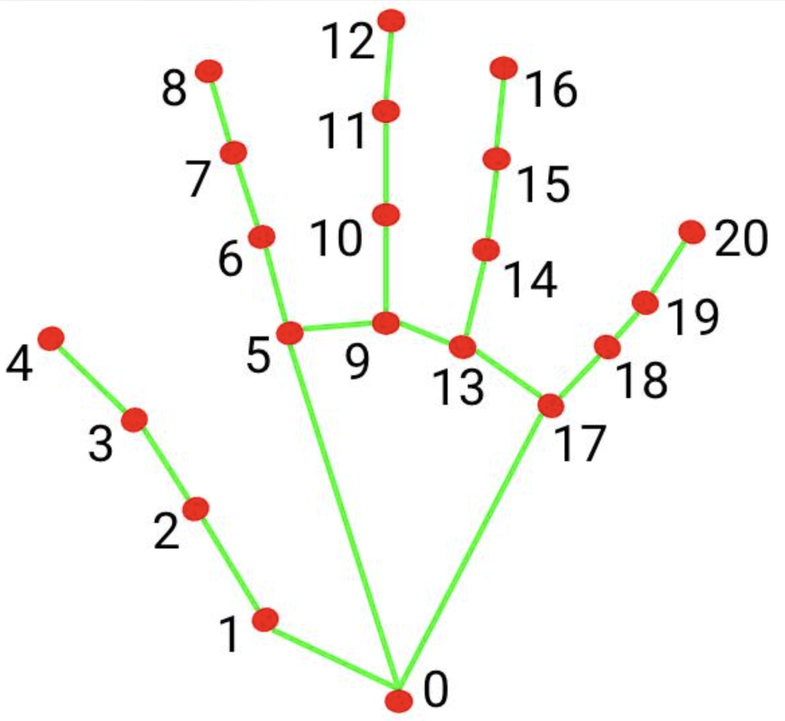
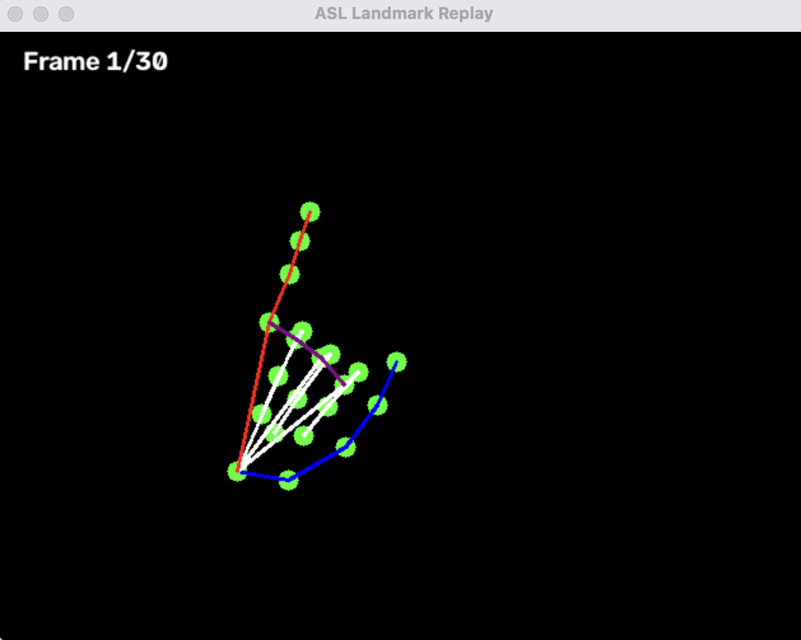
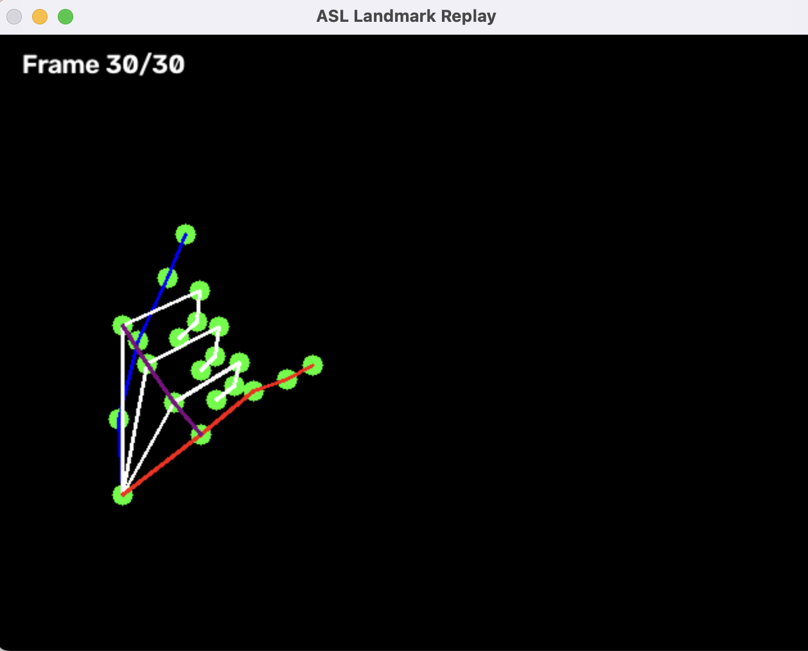
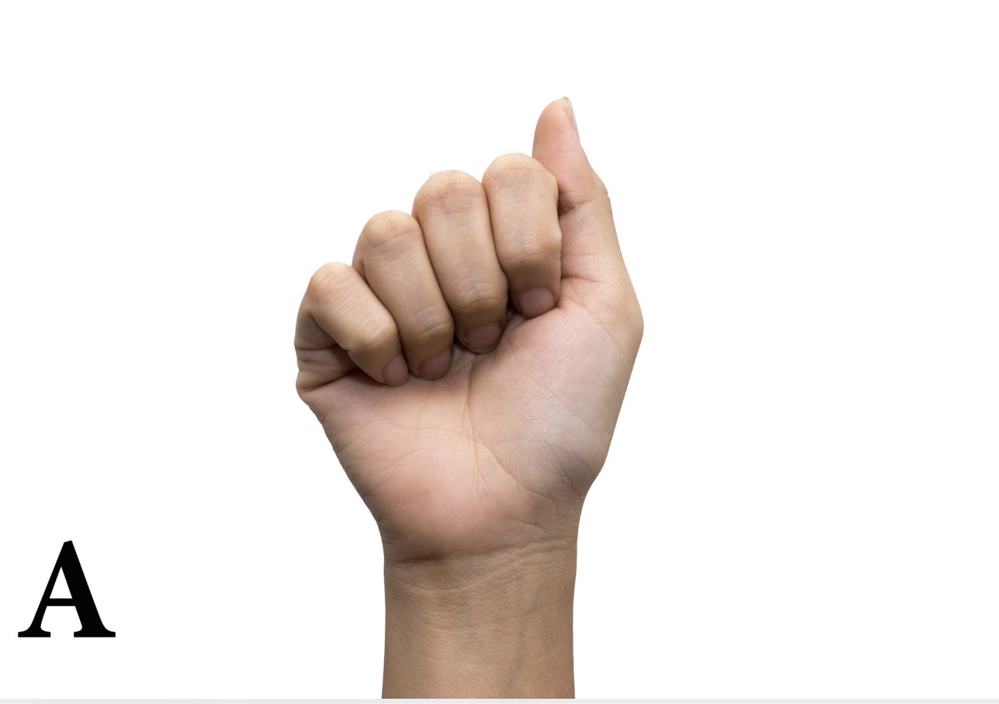
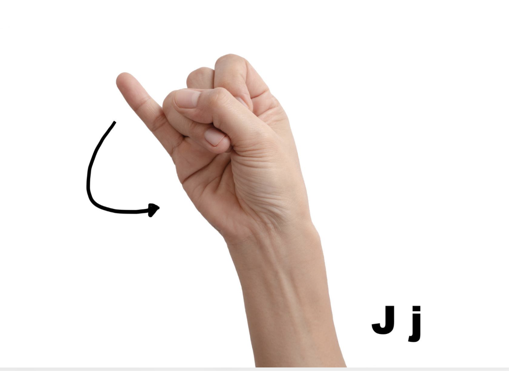

# ASL Sign Recognition System 🖐

An American Sign Language (ASL) recognition prototype built with Python, MediaPipe, OpenCV, and PyTorch. The project uses hand landmark tracking and an LSTM neural network to recognize three signs: **A, J, and NAME**.

The current version includes webcam based data collection, landmark visualization, model training, and evaluation.

## Tech Stack

**Python · MediaPipe · OpenCV · NumPy · PyTorch · scikit-learn**

## Current Implementation

- Real time webcam hand tracking using MediaPipe
- Extracts 21 landmarks per hand with wrist relative coordinates
- Supports left and right hands with 132 features per frame
- Uses absolute wrist positions and hand presence flags
- Records 30 frame sequences as NumPy (`.npy`) files
- Interactive landmark replay viewer with color coded hand skeletons
- Frame by frame navigation using keyboard arrow keys
- Automatic discovery of recording labels
- LSTM neural network trained using PyTorch
- Model evaluation using accuracy, precision, recall, F1 score, and a confusion matrix

## Hand Landmark Representation

MediaPipe detects 21 landmarks per hand, each containing x, y, and z coordinates.



Each hand is represented by 66 features:
- 63 wrist relative landmark coordinates (21 × 3)
- 2 absolute wrist coordinates (x, y)
- 1 hand presence flag

Together, both hands produce **132 features per frame**.

Wrist relative coordinates represent handshape independently of wrist position, while absolute wrist coordinates preserve spatial movement information.

## Landmark Replay

Built an interactive replay viewer that reconstructs hand skeletons from saved numerical features. This allows visual inspection of recorded movements without storing the original webcam video.

| Frame 1/30 | Frame 30/30 |
|---|---|
|  |  |

## Supported Signs

The current prototype recognizes three labels: **A**, **J**, and **NAME**.

| Letter A | Letter J |
|---|---|
|  |  |

## Dataset and Model

Collected **180 labeled recordings**, with 60 recordings per sign.

Each recording contains 30 consecutive frames, with 132 features per frame.

**Model architecture:**
- Input: 30 frames × 132 features
- LSTM layer: 64 hidden units
- Fully connected layer: 3 output classes
- Loss function: Cross Entropy Loss
- Optimizer: Adam
- Training: 100 epochs

The dataset was divided into training, validation, and testing sets using a stratified 70/15/15 split.

## Model Evaluation

| Metric | Result |
|---|---|
| Training recordings | 126 |
| Validation recordings | 27 |
| Test recordings | 27 |
| Training accuracy | 100% |
| Validation accuracy | 100% |
| Test accuracy | 100% |
| Test predictions correct | 27/27 |

**Test Confusion Matrix**

```text
           Predicted
           A   J   NAME
Actual A   9   0    0
       J   0   9    0
    NAME   0   0    9
```

The model achieved 100% accuracy on the held out test set. However, the dataset is small and self collected, and the random split may contain recordings captured under similar conditions. Further testing is needed to evaluate generalization across different users and environments.

The trained model parameters are saved in `asl_lstm_v1.pth`.

## Technical Challenges

- **Handshape vs. movement:** Used wrist relative coordinates to represent handshape while preserving absolute wrist positions to capture movement.
- **Data quality:** Developed a frame by frame replay viewer to inspect landmark sequences before training.
- **Sequence recognition:** Used an LSTM to learn temporal patterns across 30 frames, supporting both static and movement based signs.
- **Model evaluation:** Used stratified data splitting and a confusion matrix to examine classification performance across all three labels.

## Future Improvements

- Integrate real time webcam predictions using the trained LSTM
- Expand the dataset to recognize additional ASL signs
- Test with different users and recording environments
- Improve generalization using more diverse training data

**Status:** ASL Sign Recognition v1 completed. Data collection, landmark replay, LSTM training, and offline model evaluation are implemented. Live webcam classification is planned for a future version.